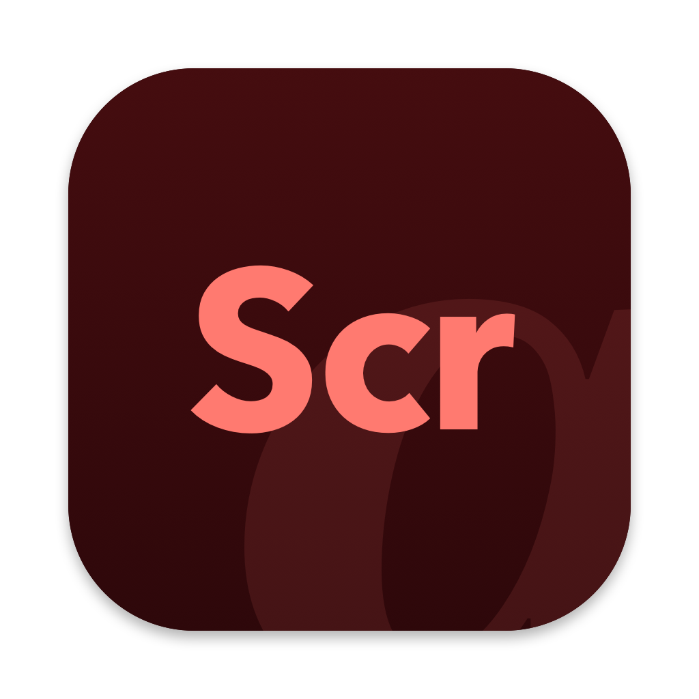
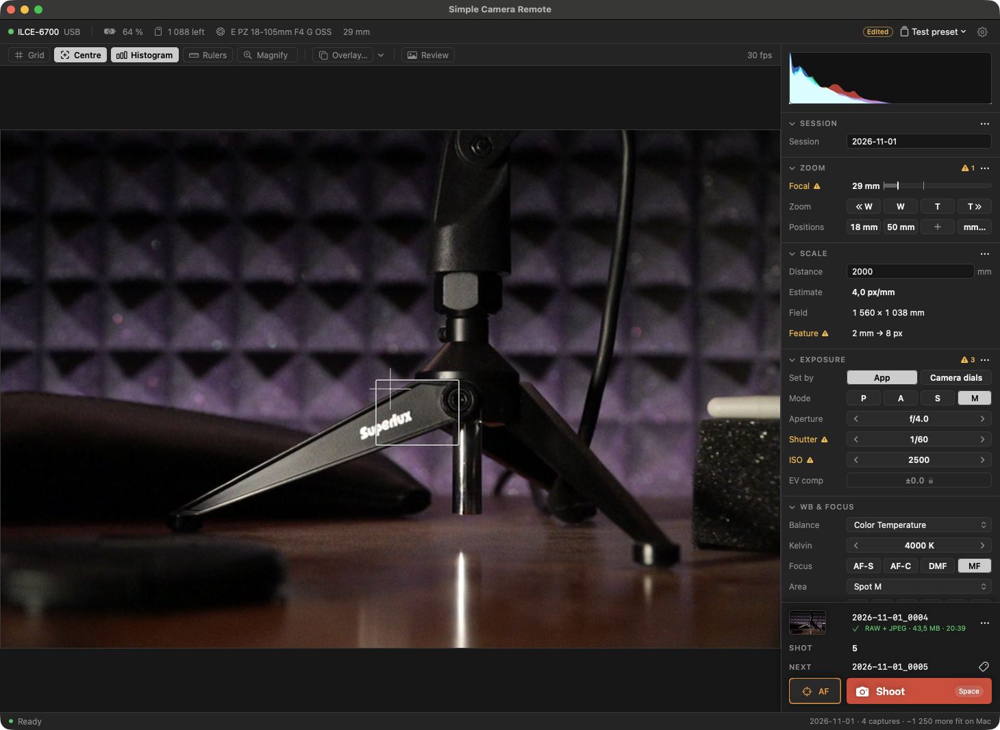
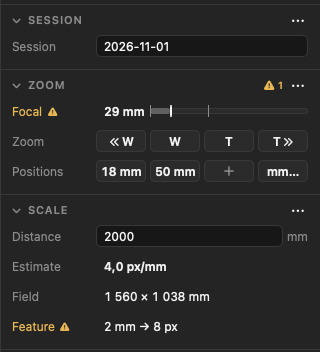
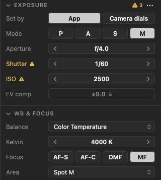
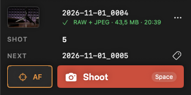

<div align="center">



<h1>Simple Camera Remote</h1>

Free, open-source <strong>tethered shooting for Sony Alpha cameras on macOS</strong>.<br/>
Live view, exposure, focus and power zoom, with every shot saved to your Mac <strong>and</strong> the card.

<br/>

<a href="https://github.com/MarecekW/simple-camera-remote/releases/latest">
  
</a>
&nbsp;

&nbsp;

&nbsp;


<br/>
<br/>

</div>

> [!NOTE]
> **Why this exists:** Sony's Imaging Edge Desktop (Remote) often doesn't detect the camera on macOS, and when it does, it's laggy and some of its buttons and sliders show no labels, which makes it hard to use. Sony's Monitor & Control works well but only shoots video, and other tethering apps are paid. This is a free, native alternative. It was built for a research dataset (5,000+ shots so far), so it's made for repeatable work, but it suits any tethered shooting.

<br/>

<div align="center">
  
</div>

<br/>

## ✨ Features

|     |                                                                                                                                                                                                                                                                                              |
| --- | -------------------------------------------------------------------------------------------------------------------------------------------------------------------------------------------------------------------------------------------------------------------------------------------- |
| 📷  | **Live view** at 1024 × 680 px and ~30 fps, with grid, histogram, focus peaking and an overlay for lining up shots                                                                                                                                                                           |
| 🎯  | **Focus** — click the live view to focus there, focus magnifier, manual focus steps, focus mode and area                                                                                                                                                                                     |
| 🎛️  | **Exposure** — mode, aperture, shutter, ISO, exposure compensation and white balance, from the app or the camera's dials                                                                                                                                                                     |
| 🔭  | **Power zoom** — zoom, go to a focal length in mm, and three saved zoom-and-focus positions                                                                                                                                                                                                  |
| 💾  | **Capture** — RAW + JPEG to your Mac and the card, named from a template, with each shot's settings saved in a .json file beside it and in a session.csv; delete the last shot to retake it; tag a shot as a calibration frame (ColorChecker, white card or ruler) and its file name says so |
| 🔍  | **Review** — the last shot at full resolution, with clipping and sharpness                                                                                                                                                                                                                   |
| 🗂️  | **Presets** — save exposure, white balance, focus and image settings, plus the grid, guides and overlay, and recall them in one click or with ⌘1–⌘9 (zoom isn't included)                                                                                                                    |
| ⌨️  | **Shortcuts** — set your own keys, e.g. on a wireless numpad so you can shoot from beside the subject                                                                                                                                                                                        |
| 🧪  | **Checks** — warns about settings that make shots inconsistent, such as auto exposure, auto ISO, auto white balance or a shutter speed that bands under mains lights; for datasets also reduced quality and any setting changed since the session's first shot (Settings › Checks)           |
| 📏  | **Scale** — pixels per mm and field of view, rulers and guides on the live view                                                                                                                                                                                                              |
| 🪵  | **Wood strip capture** _(optional, Settings › Capture)_ — for shooting loads of strips from four sides: files are named by pallet, grade, load and side, the side moves on after each shot, and the next load starts after side 4                                                            |

<br/>

<div align="center">
  <table>
    <tr>
      <td align="center" valign="top">
        <br/>
        <sub><strong>Session, zoom and scale</strong></sub>
      </td>
      <td align="center" valign="top">
        <br/>
        <sub><strong>Exposure, white balance and focus</strong></sub>
      </td>
      <td align="center" valign="top">
        <br/>
        <sub><strong>Last shot, next file name and the Shoot button</strong></sub>
      </td>
    </tr>
  </table>
</div>

<br/>

## 📦 Installation

### Download a release _(recommended)_

Releases run on Apple Silicon Macs with macOS 14 or later.

1. Grab `simple-camera-remote.app.zip` from the [**latest release**](https://github.com/MarecekW/simple-camera-remote/releases/latest).
2. Unzip it and drag `Simple Camera Remote.app` to `/Applications`.
3. **First launch only:** macOS blocks the app because it isn't signed with a paid Apple Developer ID. Either:
   - open the app and close the warning. Then go to **System Settings › Privacy & Security**, click **Open Anyway** and confirm. macOS won't ask again. Or,
   - in Terminal: `xattr -dr com.apple.quarantine "/Applications/Simple Camera Remote.app"`

The app checks GitHub for new releases and shows a dot on the Settings gear when a new version is available. It never downloads or installs anything by itself.

### Build from source

Requires macOS 14 or later and the Swift 6.2 toolchain or newer (Xcode 26+).

```sh
git clone https://github.com/MarecekW/simple-camera-remote.git
cd simple-camera-remote
./scripts/make-app.sh
open "build/Simple Camera Remote.app"
```

- `./scripts/make-release.sh`: the same app, zipped
- `swift run camera-remote-app`: run it for development
- `swift test`: run the tests
- `swift run camera-remote-cli`: a command-line probe for the camera's protocol (properties, events, live view, zoom, focus)
- `swift scripts/make-icon.swift Sources/CameraRemoteApp/Resources/AppIcon.png`: redraw the icon, which is drawn in code

<br/>

## 🔌 Connect the camera

1. Turn the camera on and connect it to your Mac with a USB cable.
2. When the camera asks, choose **Remote Shoot (PC Remote)**. The app finds it by itself.

If the camera doesn't ask, or to skip the question next time, set **MENU › Setup › USB › USB Connection Mode** to **PC Remote**.

<br/>

## 🎯 Compatibility

| Camera                                                                      | Status                                                                    |
| --------------------------------------------------------------------------- | ------------------------------------------------------------------------- |
| **Sony A6700**, firmware 2.00, with the E PZ 18-105mm F4 G OSS              | ✅ &nbsp; Tested on hardware                                              |
| Other Sony Alphas with PC Remote over USB (e.g. A7 IV, A7R V, A7C II, FX30) | 🟡 &nbsp; Untested — may work; scale and rulers assume the A6700's sensor |

- **Lenses:** any E-mount lens should work (tested with the E PZ 18-105mm F4 G OSS). Zoom controls need a power-zoom (PZ) lens; with any other lens the Zoom section shows "Fixed or manual zoom".
- **Settings:** menus show only the values your camera reports, so they adapt to each body.
- **Firmware:** a camera update can change behaviour. If something's off, say which firmware your camera has.
- **macOS:** requires macOS 14 or later; so far tested only on macOS 27 on Apple Silicon.

<br/>

## ⌨️ Shortcuts

**Space** shoots, **A** (hold) autofocuses, **W** / **T** zoom, **S F I E** step shutter, aperture, ISO and exposure compensation. **Settings › Shortcuts** lists them all and lets you set your own keys.

<br/>

## 🛠️ How it works

<details>
<summary><strong>Tech tour (click to expand)</strong></summary>

<br/>

macOS's `ptpcamerad` claims every PTP camera as soon as it appears, so Sony's Camera Remote SDK (which needs the USB device to itself) can't connect. Sony's own Monitor & Control app gets around this by sending Sony's vendor PTP commands **through** the system with ImageCaptureCore — and so does this app: `requestSendPTPCommand` with Sony's SDIO operations.

| Operation              | Use                                                                                 |
| ---------------------- | ----------------------------------------------------------------------------------- |
| `0x9201`–`0x9202`      | Handshake, the camera's property and control list                                   |
| `0x9209`               | All properties in one dataset, read every ~2 s and after each change event          |
| `0x9205`               | Set a property (exposure, white balance, focus, image quality…)                     |
| `0x9207`               | Press a button or drive the lens (shutter, AF, zoom, AF point, magnifier, MF steps) |
| `GetObject 0xFFFFC002` | A live-view JPEG, with the camera's AF frames                                       |

The code is in four layers: `SonyProtocol` (wire formats, no I/O), `SonyRemote` (the camera session over ImageCaptureCore), `CaptureCore` (sessions, naming, sidecars, checks, presets — plain Swift, unit-tested), and the SwiftUI app.

**Camera quirks worth knowing:**

- The A6700 has no absolute zoom or focus position over USB; exact lens positions come only from its zoom-and-focus preset slots 1–3. Saving to slot 20 crashed the camera, so the app never sends any other slot.
- The exposure mode can only be set from the app while the PC has priority (`0xD25A`), which also locks the camera's dials. The app hands the dials back when it quits.
- Live-view AF frames list height before width.

Reference: [docs/HARDWARE_NOTES.md](docs/HARDWARE_NOTES.md) (what the A6700 does over USB, verified on hardware) and [docs/PROPERTY_VALUES.md](docs/PROPERTY_VALUES.md) (every property value decoded, with sources).

</details>

<br/>

## 🤝 Contributing

The app is tested on one body, the A6700. Other Sony Alphas with **PC Remote** over USB may use the same protocol, but none has been tried yet. If you own one:

1. Grab the [latest release](https://github.com/MarecekW/simple-camera-remote/releases/latest) and connect your camera.
2. Check that it connects, that live view, exposure and focus work, and that a shot lands on your Mac and the card.
3. [Open an issue](https://github.com/MarecekW/simple-camera-remote/issues/new/choose) with your camera, firmware, lens and macOS version, and what worked or didn't. That's how a body moves from 🟡 untested to ✅ tested.

Bug reports and feature ideas are welcome as issues too. For anything beyond a small fix, please open an issue before a pull request so we can talk it through.

<br/>

## 🙏 Credits

- **libgphoto2** — its Sony PTP property names and values were the main cross-reference for decoding the camera.
- [**alpha2go**](https://github.com/knallli/alpha2go) — a Go client written against the A6700, a cross-reference for the live-view focus frames and controls.
- **Sony's Camera Remote SDK** documentation, read for property meanings; no SDK code is used or shipped.

<br/>

## 📜 License

Released under the [MIT License](LICENSE).

This is an independent project. It is not affiliated with, endorsed by, or supported by Sony. "Sony" and "Alpha" are trademarks of Sony Group Corporation.

<br/>

<div align="center">
<sub>Built by <a href="https://github.com/MarecekW">@MarecekW</a> · co-authored with Claude</sub>
</div>
